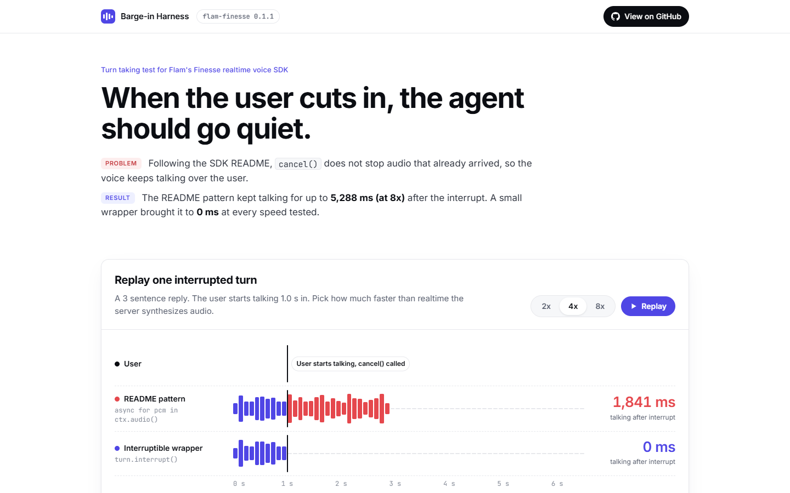

<p align="center"><a href="https://finesse-bargein-harness.vercel.app"></a></p>

**Problem:** following the Finesse SDK README, `cancel()` does not stop audio that already arrived, so a voice agent keeps talking after the user interrupts it.

**Result:** after `cancel()`, the README playback pattern kept talking for **1,086 ms at 2x, 1,841 ms at 4x and 5,288 ms at 8x** synthesis speed. The `Interruptible` wrapper went quiet in **0 ms** at every speed (`results/results.json`, against a local mock, not Flam's service).

**[Try it live: finesse-bargein-harness.vercel.app](https://finesse-bargein-harness.vercel.app)** (the demo site is in `demo/`; `python demo/build_data.py` copies `results/results.json` into it)

---

# flam-proof: barge-in and time-to-first-audio checks for Finesse realtime

A small offline harness that drives Flam's public Python SDK (`flam-finesse` 0.1.1) against a
local mock of its realtime WebSocket, and measures two things a talking character depends on:
how fast the first audio arrives, and how fast the character goes quiet when the user talks
over it (barge-in).

## The problem (public sources, read 20 Nov 2026)

Flam's Visual Agents page (https://flamapp.ai/en-US/products/visual-agents) states the latency
budget for the whole pipeline:

> "Retrieval → generation → TTS with personalized voice cloning → frame buffering all under 800ms"

The voice part of that pipeline is public as the Finesse SDK
(https://github.com/homingos/finesse-python, PyPI `flam-finesse`, commit `392b287`, 16 Nov 2026).
Its README documents barge-in like this:

> "When the user starts talking, cancel the turn. Audio still on its way for that context is
> dropped, and iterating the context ends with a `TaskCancelled` event."

and shows this playback pattern:

```python
async def speak() -> None:
    async for pcm in ctx.audio():
        speaker.write(pcm)
```

Reading `src/flam_finesse/realtime.py` shows two gaps between that promise and that pattern:

1. **Buffered audio still plays after `cancel()`.** `cancel()` drops audio that *arrives* after
   it (`_on_audio` checks `ctx.cancelled`), but audio that already arrived sits in the context's
   unbounded `asyncio.Queue`, and `__aiter__` yields it without checking `cancelled`. If synthesis
   runs faster than realtime, the queue holds the rest of the sentence or turn, and a player using
   the README pattern keeps talking.
2. **`cancel()` is a no-op once `task_done` has arrived.** `cancel()` starts with
   `if self._ended or self.cancelled: return`, so when the server already finished the turn
   (fast engine, short reply), `ctx.cancelled` is never set, no `task_cancel` is sent, and the
   whole buffered turn plays.

For a visual agent this is the moment users notice most: the face keeps talking after they
interrupt it.

The second check (TTFA) comes from the same SDK: `idle_flush_ms` "Speak a pending sentence after
this many ms without new text", with a server default of 800 ms per the `pipecat-finesse` plugin
docstring (https://github.com/homingos/pipecat-finesse, `src/pipecat_finesse/tts.py`). So an LLM
that pauses mid-sentence can spend the whole 800 ms budget waiting on the flush timer alone.

## What was built

| File | What it is |
|---|---|
| `finesse_mock.py` | A local `finesse.v1` WebSocket server that speaks the message shapes the SDK sends and parses (`task_start`, `task_continue`, `task_cancel`, `audio_chunk` + binary PCM, `sentence_done`, `task_done`, `task_cancelled`). Timing is synthetic and configurable: per-sentence latency, generation speed vs realtime, chunk size, idle flush. |
| `harness.py` | Runs turns through the **real, unmodified SDK** with a player that plays in real time (sleeps for each chunk's duration, like a blocking `speaker.write`). Measures TTFA, stale speech after cancel, silence latency, turn end. Also holds the fix, `Interruptible`. |
| `bench.py` | Runs the sweep and writes `results/results.json` and `results/report.md`. |
| `tests/test_turn_taking.py` | 10 tests: protocol round trip, sentence splitting, both gaps reproduced, the fix, and the TTFA flush effect. |

**The fix** (`Interruptible`, public API only): wrap the context, call `interrupt()` instead of
`cancel()`. It keeps its own flag, so it covers both gaps, skips any audio already queued, and
still reads the turn to its normal end (`TaskCancelled` or `TaskDone`).

```python
turn = Interruptible(ctx)
async for event in turn:           # instead of: async for event in ctx
    if isinstance(event, AudioEvent):
        speaker.write(event.pcm)
...
await turn.interrupt()             # on barge-in, instead of: await ctx.cancel()
```

A possible SDK-side fix (not applied, not tested against Flam's code base): in `cancel()`, set a
flag even when the context already ended, and have `__aiter__` skip `AudioEvent`s once it is set.

## How to run

Python 3.10+. Everything runs offline on CPU; no API key and no network.

```sh
pip install -r requirements.txt
python bench.py             # about 30 s, mostly real-time playback
python -m pytest -v tests   # about 11 s
```

## Results (one run on a laptop, Python 3.12.10, flam-finesse 0.1.1, against the mock)

Barge-in: the user interrupts after 1.0 s of a ~5.9 s turn (3 sentences).

| generation speed | player | task_done already in? | stale speech after cancel | silence latency | turn end |
|---|---|---|---|---|---|
| 1x realtime | sdk_pattern | False | 0.00 s | 0 ms | 1 ms |
| 1x realtime | interruptible | False | 0.00 s | 0 ms | 1 ms |
| 2x realtime | sdk_pattern | False | 1.00 s | 1086 ms | 1086 ms |
| 2x realtime | interruptible | False | 0.00 s | 0 ms | 2 ms |
| 4x realtime | sdk_pattern | False | 1.70 s | 1841 ms | 1841 ms |
| 4x realtime | interruptible | False | 0.00 s | 0 ms | 2 ms |
| 8x realtime | sdk_pattern | True | 4.80 s | 5288 ms | 5288 ms |
| 8x realtime | interruptible | True | 0.00 s | 0 ms | 0 ms |

Time to first audio (mock: 150 ms per sentence; the LLM pauses 1.0 s inside its first sentence):

| scenario | idle_flush_ms sent | TTFA | within 800 ms |
|---|---|---|---|
| pause mid first sentence | none (mock default 800) | 956 ms | False |
| pause mid first sentence | 200 | 367 ms | True |
| pause after a full first sentence | none (mock default 800) | 150 ms | True |

Tests: `10 passed in 11.16s`.

How to read these: the barge-in rows show the **shape** of the gap (stale speech grows with how
far synthesis runs ahead of playback, and at 8x the whole rest of the turn plays because
`cancel()` became a no-op). The TTFA rows mostly echo the mock's own settings plus the flush
timer; they show why the timer matters, not how fast Finesse is.

## Honest limits

- **The server is a mock, not Flam's service.** It was written from the public SDK's parser and
  README, not from a server spec. Real Finesse timing, sentence splitting and idle-flush
  behaviour may differ. No number here is a measurement of Finesse.
- The two client-side gaps are in the SDK's own code and reproduce with the unmodified SDK, but
  whether they show up in production depends on how far real synthesis runs ahead of playback,
  which I could not measure without an API key.
- Only the Python SDK was checked. The Node SDK, the LiveKit plugin and the Pipecat plugin were
  not tested; Pipecat manages its own audio contexts and may not be affected.
- The 800 ms server idle-flush default comes from a docstring in `pipecat-finesse`, not from an
  API reference.
- Local loopback has no network delay; a real deployment adds round trips to every number.
- "Playback" is a sleep, not a speaker or a lip-sync renderer.
